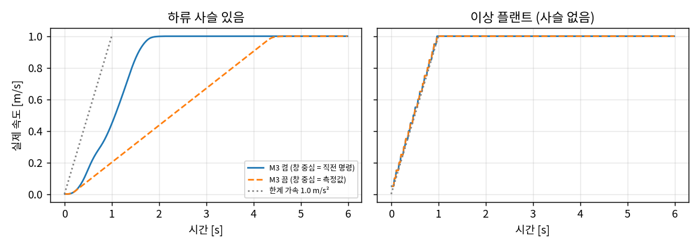
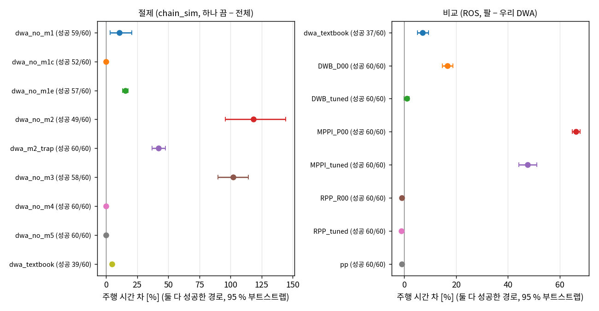

# DWA 절제·고전 제어기 비교 결과

측정 조건: 커밋 `6e12aea` (사전 등록 `prereg.md` 포함, 코드 dirty 0), 이미지 `amr-ai/rl:0.3` (ROS 2 Humble, Nav2 1.1.20),
시뮬레이션만 — ① ROS 운동학 시험대 (실제 Nav2 controller_server + velocity_profiler_node + kinematic_sim 서보 모형,
벽시계 실시간, **공유 부하 하 예비값**: 실행 시작 loadavg 5–185 / 32 코어, 중앙 83) ② ROS 없는 결정적 시험대 chain_sim.
held-out 60 경로 (매끈 32 · 좁은 통로 8 · 창고 A* 20), 2026-10-14 02:43–05:29 KST (리뷰 반영 chain_sim 궤적 재실행은
05:55–05:59, §11). 실로봇·Gazebo 없음, 움직이는 장애물 없음.

원자료 `/home/CAPYI_AI/runs/dwa-abl/raw/` (JSONL, 실행마다 한 줄), 실행 기록 `runs.jsonl`, 표 원본 `analysis/tables.md`
(사전 등록 `scripts/analyze.py`), 사후 분석 `analysis/posthoc.md` (`scripts/posthoc.py`), 리뷰 반영 사후 분석
`analysis/review_fix.md` (`scripts/review_fix.py`, §11). 모든 수치는 [측정] (시뮬레이션 측정, 명령·원자료 있음)이고,
구간은 경로 묶음 부트스트랩 95 % (B 10 000) 다.

## 0. 한 줄 결론

추종만 보면 **우리 DWA 는 이기지 못했다** — 같은 사슬·같은 held-out 경로에서 Nav2 RPP(기본값 그대로)와 우리 PP 가
조금 더 빠르고(−1.0 %) 곡선 추종도 조금 낫다(−0.3–0.4 cm). 오도메트리 잡음 σ 0.02 에서는 우리 DWA 만 **일부 실행이 크게
느려진다** — ROS 60 실행 중 16 실행이 +31–81 %, 나머지 44 실행은 중앙 +0.7 % (경로 평균 +15 % [+10, +22]; 다른 Nav2·PP
팔은 −0.6 – +2.1 %). 가속이 늦은 것이 아니고, chain_sim 궤적에서 같은 꼴의 느린 실행은 대부분(15/17) 목표 부근에서 판정을
놓치고 지나쳤다 되돌아오는 것이었다 (ROS 는 궤적 없음, §6).
우리 DWA 가 앞선 것은 Nav2 제어기 대비 목표 정지 오차(0.9–6.6 cm 작음), DWB 대비 곡선 추종(1.2–5.4 cm), MPPI 대비 시간(48–66 %)뿐이다.
절제에서는 **M3(창 중심 = 직전 명령)이 확증**됐다 — 사전 등록 H1: **stateful false goal checker · 후진 없음 조건에서** 끄면
주행 시간 +102 % [+90, +114]. 이 +102 % 의 대부분(추가 시간 합의 85 %)은 감속도 늦어져 목표를 지나쳤다(53/58 경로, 중앙
1.24 m) 되돌아오는 시간이고, 목표 0.10 m 첫 진입까지의 도착 지연은 +13 % [+10, +16] 이다. 조건 없이 일반화할 몫은 실효 가속
0.226 대 0.573 m/s² (0.39 배, 0 → 0.9 m/s 1.57 → 3.99 s) 이다. 이상 플랜트의 차 0 은 구성상 같아야 하는 확인이지 독립 증거가
아니다 (§4). M1·M1-c·M1-e·M2 도 뚜렷한 몫이 있다. M4-a(속도별 지평)는 배포 조건에서 정의상 상수라 0 이고, M4-d(제동 후보)는
유효 후보가 하나도 없는 주기에서만 쓰여 이 시험대에서 0 (잡음 294/300 동일), M5 는 0 에 가깝다.

## 1. 불리한 것 먼저

1. **우리 DWA 가 Nav2 RPP·우리 PP 보다 추종이 낫지 않다** (표 1). ROS held-out 60 경로에서 RPP 기본은 주행 시간
   −1.0 % [−1.4, −0.5], 곡선 CTE 평균 −0.4 [−0.6, −0.2] cm, 우리 PP 는 −1.0 % [−1.4, −0.6], −0.3 [−0.4, −0.2] cm.
   좁은 통로에서 RPP·PP 의 CTE 최대가 약 3 cm 작고 (−3.4 / −3.0 cm), 우리 DWA 의 통로 최소 여유 최솟값 4.8 cm 는
   RPP·PP·MPPI 의 6.7–7.8 cm 보다 작다 (DWB 기본만 1.2 cm 로 더 작다). 정지 출발 가속도 느리다: ROS held-out
   0 → 0.9 m/s 시간 중앙이 우리 DWA 1.69 s, RPP·PP 1.31 s, DWB 1.33 s 다 (사후, §11). M3 재설정 임계 0.3 m/s 가 가속 중에도
   발동하는 탓으로 보인다 — chain_sim 탐침에서 임계를 0.4 로 올리면 1.57 → 1.31 s 다 (§6, 사후).
2. **오도메트리 잡음에 약하다 — 고르게가 아니라 일부 실행이 크게 느려지는 꼴로** (표 1b, §6). σ_v = σ_ω = 0.02 에서
   ROS 12 경로 × seed 5 의 우리 DWA 60 실행 중 **16 실행이 +31–81 %** 느려졌다 (12 실행은 +47 % 이상). 나머지 44 실행은
   −2.7 – +26 % (중앙 +0.7 %, 42 실행이 +6.5 % 이하) 다. 처음 적은 "경로 평균 +16 %" 는 이 이봉 분포의 평균이다
   (실행별 산술평균 +16.0 %, 중앙 +1.3 %, 경로 단위 +15.4 % [+9.7, +22.0]). 느린 실행은 가속이 늦은 것이 아니다 —
   0 → 0.9 m/s 시간 중앙이 나머지 실행과 같은 1.84 s 이고, CTE 최대 중앙이 24.8 cm (나머지 3.1 cm) 다. chain_sim 은
   held-out 60 경로 기준 **+5.8 % [+3.7, +8.7]** (299 실행 중 17 실행이 +31 % 이상, 실행 중앙 +0.4 %) 이고 ROS 와 같은
   12 경로만 보면 +10.5 % [+2.4, +24.3] 이다 — 처음 적은 "+13 % (chain_sim)" 는 다시 계산해 나오지 않아 철회한다.
   같은 조건에서 다른 팔은 ROS −0.6 – +0.4 % (MPPI 튜닝만 +2.1 % [−3.6, +8.3]), chain_sim PP +0.9 %, 교과서 DWA
   +1.4 % (chain_sim 35 경로) · +5.1 % [+0.4, +13.5] (ROS 9 경로) 다. 잡음 조건 짝 비교에서 RPP·PP·DWB 튜닝이 우리 DWA
   보다 13.5–15.2 % 빠르다 (표 1b). chain_sim 궤적에서 느린 실행 17 개 중 15 개는 목표 부근에서 지나쳤다 되돌아오는
   것이었고 (2 개는 좁은 통로 안 멈칫), 목표 직전 감속 중 창 중심 재설정(임계 0.3 m/s)이 그 정황이다 — 사후 탐색이라 확증이 아니고, ROS 실행은 궤적을 남기지 않아 기제를
   직접 보지 못했다 (§6).
3. **명령이 거칠다**: 제어기 출력의 저크 p99 가 우리 DWA 60.5 m/s³ (ROS), RPP 8.0, PP 6.1, MPPI 1.6–13.3.
   1 주기 창이라 가속을 매 주기 ±a 로 뒤집는다. 하류 프로파일러가 2 m/s³ 로 자르므로 로봇 명령은 모두 같다.
4. **목표에서 늘 2 cm 못 미쳐 선다** (정지 오차 중앙 −2.0 cm, PP +0.5 cm). 접근 지연 t_c 0.3 s 가 이 사슬에서 조금
   과보상이다.
5. **M4 와 M5 는 이 시험대에서 몫을 보여 주지 못했다.** M4-a 는 배포 조건(가속 1.0, 최고 1.0 m/s)에서 지평이 상수라
   60/60 경로가 비트 단위로 같고, M4-d 제동 후보도 잡음 없는 경우 60/60 같다 (잡음 조건 294/300 같음). M5 는 54/60 같고
   통로 최소 여유 차 −0.6 [−1.6, +0.4] cm 로 0 과 구별되지 않는다 — 전역 경로 편향 0–4 cm 로는 재중심이 할 일이 없다.
6. **교과서 DWA 팔은 튜닝하지 않았다** (사전 등록대로). Nav2 제어기는 12 설정 격자에서 골랐는데 교과서 팔은 우리 가중치
   (0.6/1.0/0.4)와 목표점 1.2 m 를 그대로 썼다. 교과서 팔의 실패(ROS 23/60)는 대부분 "목표를 0.8 m/s 안팎으로 지나치며
   yaw 오차가 0.05 rad 를 넘어 판정을 놓치고, 후진이 없어 되돌아오다 시간 초과" 다 (§3.3). 따라서 "교과서 DWA 대비"
   수치는 **튜닝하지 않은 교과서 DWA 대비**로만 쓸 수 있다.
7. **목표 판정이 stateful false 라서 M2·M3 의 몫이 커 보인다.** 배포 goal checker 는 xy 0.10 m 와 yaw 0.05 rad 를
   같은 순간에 요구한다. Nav2 기본(stateful true)이면 지나치는 순간 xy 가 잠겨 제자리 정렬만 남으므로 "지나쳐 되돌아오기"
   비용이 훨씬 작을 것이다 — 이 연구는 stateful true 를 재지 않았다. M3 끔의 +102 % 도 그렇다: 목표 0.10 m 첫
   진입까지의 도착 지연은 +13 % [+10, +16] (중앙 +1.0 s) 이고, 추가 시간 합의 85 % 는 첫 진입 뒤 지나침·복귀다 (§4).
   지나침 자체는 M3 끔이 감속도 늦춘 결과다 (첫 진입 속도 중앙 0.87 대 0.31 m/s). stateful true 면 이 비용이 시간 대신
   정지 위치 오차로 나타날 것으로 본다 [추론, 미측정].
8. 사전 등록에서 "M3 끔의 a_eff 가 제어 주기 Δt_c 에 비례" 를 예상했는데 **맞지 않았다** (10/20/40 Hz 에서 0.335/0.226/0.139
   m/s², 비례라면 0.45/0.226/0.113). 설명 모형 a_eff ≈ a·Δt_c/τ_eq 는 주장하지 않는다 (§4).
9. ROS 시험대는 공유 부하(loadavg 중앙 83, 최대 185) 아래 실시간으로 돌았다. 모든 실행의 실제 명령 주기는 19.7–20.1 Hz
   로 유지됐지만 (18 Hz 미만 0 건) 계산 시간·시간 지표는 예비값이다.

## 2. 고전 제어기 비교 (표 1)

ROS 시험대, held-out 60 경로, 잡음 없음 (LiDAR σ 0.03 은 늘 있음), 1 회씩. 튜닝: DWB·MPPI·RPP 각 12 설정을 튜닝 집합
4 경로에서 사전 등록 기준으로 골랐다 — DWB **D02** (sim_time 1.0), MPPI **P10** (PathAlign 20 · PathFollow 10 ·
vx_std 0.3 · wz_std 0.6), RPP **R03** (속도 비례 lookahead 0.4–1.2 m · 0.8 s). 순위 전체는 `analysis/tuning_selection.json`.

| 팔 | 성공 매끈/통로/A* | T/T_ref 중앙 | CTE 직선 평균/최대 [cm] | CTE 곡선 평균/최대 [cm] | 정지 오차 중앙 [p10, p90] [cm] | 제어기 출력 저크 p99 [m/s³] | 계산 [ms/주기] |
| --- | --- | --- | --- | --- | --- | --- | --- |
| **우리 DWA** | 32/32 / 8/8 / 20/20 | 0.985 | 0.2 / 1.4 | 0.8 / 3.1 | −2.0 [−2.5, −0.9] | 60.5 | 1.43 |
| 교과서 DWA (수정 전부 끔) | 18/32 / 6/8 / 13/20 | 1.032 | 0.2 / 1.7 | 4.6 / 10.9 | +80.6 [+78.1, +86.9] | 3.9 | 1.68 |
| DWB 기본 | 32/32 / 8/8 / 20/20 | 1.151 | 2.7 / 8.6 | 6.2 / 18.4 | −8.4 [−8.5, −8.2] | 21.1 | 13.42 |
| DWB 튜닝 (D02) | 32/32 / 8/8 / 20/20 | 0.985 | 0.8 / 2.6 | 2.4 / 6.6 | −5.0 [−6.2, −2.6] | 63.2 | 12.89 |
| MPPI 기본 | 32/32 / 8/8 / 20/20 | 1.643 | 0.4 / 0.9 | 1.1 / 3.0 | −4.3 [−5.1, −3.5] | 1.6 | 5.04 |
| MPPI 튜닝 (P10) | 32/32 / 8/8 / 20/20 | 1.444 | 0.7 / 1.4 | 0.9 / 2.2 | −2.5 [−3.5, −0.9] | 13.3 | 5.10 |
| RPP 기본 | 32/32 / 8/8 / 20/20 | 0.976 | 0.0 / 0.3 | 0.3 / 1.4 | −4.2 [−5.1, −3.3] | 8.0 | 0.25 |
| RPP 튜닝 (R03) | 32/32 / 8/8 / 20/20 | 0.974 | 0.2 / 1.4 | 0.8 / 2.9 | −4.2 [−5.0, −3.2] | 8.0 | 0.29 |
| 우리 PP | 32/32 / 8/8 / 20/20 | 0.979 | 0.1 / 1.2 | 0.7 / 2.6 | +0.5 [−0.1, +1.2] | 6.1 | 0.09 |

T_ref = L/v + v/a + a/j (정지→정지 기준 시간; 목표 판정이 0.10 m 앞에서 움직이는 중에도 통과하므로 하한은 아니다).
계산: 우리 팔은 플러그인 cycle_ms, Nav2 팔은 controller_server CPU 증가분 − 유휴분 ÷ 명령 수 (근사, 사후 4a).

우리 DWA 와의 경로별 짝 차 (팔 − 우리 DWA):

| 팔 | 주행 시간 % (n) | CTE 곡선 평균 [cm] | \|정지 오차\| [cm] |
| --- | --- | --- | --- |
| 교과서 DWA | +7.0 [+5.1, +9.3] (37, 둘 다 성공한 경로만) | +3.4 [+2.8, +4.1] | +80.2 [+78.9, +81.6] |
| DWB 기본 | +16.7 [+14.7, +18.7] (60) | +5.4 [+4.8, +6.0] | +6.6 [+6.4, +6.8] |
| DWB 튜닝 | +0.9 [−0.0, +2.0] (60) | +1.2 [+1.1, +1.4] | +2.9 [+2.5, +3.2] |
| MPPI 기본 | +66.3 [+64.9, +67.8] (60) | −0.1 [−0.2, +0.1] | +2.7 [+2.4, +2.9] |
| MPPI 튜닝 | +47.6 [+44.3, +51.1] (60) | −0.3 [−0.5, −0.0] | +0.9 [+0.5, +1.2] |
| RPP 기본 | **−1.0 [−1.4, −0.5]** (60) | **−0.4 [−0.6, −0.2]** | +2.6 [+2.2, +2.9] |
| RPP 튜닝 | **−1.2 [−1.5, −0.9]** (60) | −0.1 [−0.2, −0.0] | +2.2 [+2.0, +2.5] |
| 우리 PP | **−1.0 [−1.4, −0.6]** (60) | **−0.3 [−0.4, −0.2]** | −0.8 [−1.4, +0.1] |

- 성공은 교과서 DWA 를 빼고 모두 60/60 이다. 좁은 통로 8 개도 모두 통로 안으로 관통했다 (사후 1a).
- 경로 종류별로 나누면 (사후 계산): A* 경로(모서리 있음)에서는 MPPI 튜닝의 CTE 최대가 우리보다 4.4 [3.2, 5.7] cm 작지만
  55 % 느리고, RPP 기본과 우리 DWA 의 시간 차는 0 [−0.8, +1.0] % 다.
- 도착 시간 예측 오차(보조, 우리 예측 모형에 유리하게 편향): 우리 DWA 2.1 %, PP 2.5 %, RPP 2.8–3.2 %, DWB 튜닝 3.1 %,
  DWB 기본 13.1 %, MPPI 30.7–39.0 % (중앙값, 사후 3a).

### 2.1 잡음 조건 (표 1b)

ROS 시험대, 12 경로 (S01–S06, N1·N4·N6, A05·A06·A12) × noise_seed 1–5, 오도메트리 σ_v 0.02 m/s · σ_ω 0.02 rad/s.

| 팔 − 우리 DWA | 성공 실행 (팔 · 우리 DWA) | 주행 시간 % | CTE 곡선 평균 [cm] | \|정지 오차\| [cm] |
| --- | --- | --- | --- | --- |
| 교과서 DWA | 46/60 · 60/60 | −1.1 [−9.3, +10.2] | +3.2 [+1.8, +4.7] | +84.9 [+83.7, +86.2] |
| DWB 튜닝 | 59/60 · 60/60 | **−13.5 [−17.8, −9.5]** | +0.4 [−0.4, +1.1] | −0.7 [−1.5, −0.1] |
| MPPI 튜닝 | 60/60 · 60/60 | +28.2 [+20.3, +36.0] | −0.9 [−1.6, −0.1] | −0.2 [−1.0, +0.5] |
| RPP 기본 | 60/60 · 60/60 | **−14.8 [−19.3, −10.4]** | −1.0 [−1.9, −0.0] | −1.4 [−2.3, −0.5] |
| RPP 튜닝 | 60/60 · 60/60 | **−15.2 [−19.7, −10.9]** | −1.1 [−1.7, −0.6] | −1.3 [−2.1, −0.6] |
| 우리 PP | 60/60 · 60/60 | **−14.7 [−19.3, −10.2]** | −1.3 [−1.9, −0.7] | −1.6 [−2.4, −1.0] |

같은 12 경로에서 잡음이 들어가면 우리 DWA 의 정지 오차 중앙이 −1.7 → +2.2 cm (지나침)로 바뀌고 직선 CTE 최대 중앙이
1.4 → 6.0 cm 로 커진다. 위 시간 차 −13.5 ~ −15.2 % 는 우리 DWA 의 느린 실행 16/60 (+31–81 %) 이 끌어올린 평균이다 (§1-2).

## 3. 절제 (표 2)

chain_sim (결정적), held-out 60 경로. "결과 동일" 은 시간·CTE·정지 자세·최소 여유가 1e-9 안에서 같은 경로 수다.

| 끈 수정 | 성공 끔·켬 | 주행 시간 % (n) | CTE 곡선 평균 [cm] | CTE 직선 최대 [cm] | \|정지 오차\| [cm] | 결과 동일 |
| --- | --- | --- | --- | --- | --- | --- |
| M1 비용 → 교과서 3 항 | 59 · 60 | +10.8 [+3.2, +20.7] (59) | +4.5 [+3.2, +6.3] | +28.4 [+12.0, +48.8] | −1.8 [−2.0, −1.5] | 0/60 |
| M1-c 상대 → 절대 여유 | **52 · 60** | +0.0 (52) | +0.0 | +0.0 | +0.0 | 52/60 |
| M1-e 추종 지평 → 전체 롤아웃 | 57 · 60 | +15.3 [+13.2, +17.7] (57) | +2.5 [+2.2, +2.7] | +3.6 [+3.0, +4.2] | +5.8 [+5.0, +7.2] | 0/60 |
| M2 목표 접근 → 없음 | **49 · 60** | +118.4 [+96.0, +144.2] (49) | +4.6 [+2.9, +6.5] | +24.7 [+17.0, +33.4] | +26.2 [+16.1, +36.8] | 0/60 |
| M2 → 사다리꼴 √(2ad) (보조) | 60 · 60 | +42.3 [+37.0, +47.7] (60) | +0.6 [+0.4, +0.9] | +2.7 [+2.0, +3.5] | +1.4 [−0.4, +3.9] | 0/60 |
| M3 창 중심 → 측정값 | 58 · 60 | **+102.1 [+90.1, +114.3]** (58) | +8.3 [+6.3, +10.4] | +37.6 [+29.6, +45.6] | +3.0 [+1.5, +5.6] | 0/60 |
| M4 제동 후보·속도별 지평 → 끔·고정 1.5 s | 60 · 60 | 0 | 0 | 0 | 0 | **60/60** |
| M4-a 속도별 지평만 → 고정 1.5 s | 60 · 60 | 0 | 0 | 0 | 0 | **60/60** |
| M5 좁은 곳 재중심 → 끔 | 60 · 60 | 0.0 [0.0, 0.0] | −0.0 | −0.2 [−0.4, −0.0] | −0.0 | 54/60 |
| 전부 끔 (교과서 DWA) | **39 · 60** | +4.7 [+3.8, +5.9] (39) | +3.3 [+2.7, +3.9] | +0.1 [−0.3, +0.4] | +78.0 [+76.6, +79.5] | 0/60 |

### 3.1 수정별로 무엇이 깨지는가 (기제는 궤적·실패 원인으로 확인한 것만)

- **M1 (비용 재설계)**: 끄면 곡선 CTE +4.5 cm. 좁은 통로 8 개 중 7 개는 "성공" 했지만 **모두 통로 밖으로 랙을 돌아**
  목표에 닿았다 (최소 여유 0.42 m, 통로 안 관통 0/8 — 사후 1b). 절대 여유 항이 통로 안 후보를 벌하기 때문이다.
- **M1-c (상대 여유)**: 끄면 좁은 통로 **8/8 이 입구 앞에서 멈춰** 진행 검사 실패, 나머지 52 경로는 결과가 같다.
  선행 보고서의 "좁은 통로 입구 앞 정지 국소최소" 를 이 시험대에서 재현한 것이다.
- **M1-e (추종 지평 0.8 s)**: 끄면 곡선 CTE +2.5 cm, 시간 +15 %, 목표 앞 정지 −7.9 cm, A* 3 경로 진행 검사 실패.
- **M2 (저크·지연 포함 목표 접근)**: 궤적 확인 (S03, `runs.jsonl` explore_trace_S03): 사다리꼴은 목표 0.10 m 안에 0.78 m/s,
  yaw 오차 0.13 rad 로 들어와 판정을 놓치고 0.40 m 지나쳐 되돌아왔다 (23.1 → 29.9 s). 접근 법칙이 없으면 1.05 m 지나쳐
  75 s. 정지 오차 자체가 아니라 **지나쳐 되돌아오는 시간**이 비용이다 — §1-7 의 goal checker 조건에 달린 결과다.
- **M3 (창 중심)**: §4.
- **M4**: 배포 조건에서 T_sim(v) 가 늘 하한 1.5 s 이고 (단위 시험), 제동 후보는 유효 샘플이 하나도 없을 때만 쓰이는데 잡음
  없는 경로에서는 그런 주기가 없었다. 잡음 조건에서도 294/300 같다.
- **M5**: 결과가 같거나 0.2 cm 안에서 다르다.

잡음 조건 (표 2b, seed 5): 방향과 크기가 같다. M3 끔 +89.3 [+76.0, +102.5] %, 성공 54/60 (경로별 seed 다수결),
M2 끔 +102.4 %, M1-c 끔 좁은 통로 40/40 실패, M4-a 300/300 동일, 교과서 34/60.

ROS 확인 (표 2c, 실시간이라 "동일" 은 없다): M1 끔 +10.2 [+2.8, +20.2] %, 통로 우회 6/8·실패 2/8; M2 끔 +129.9
[+106.1, +156.4] %, 성공 54/60; M3 끔 +97.4 [+85.2, +110.2] %, 성공 57/60; 교과서 37/60. chain_sim 과 같은 방향·비슷한 크기다.

## 4. M3 와 하류 사슬 (표 3) — 확증 주장 H1

**H1 (사전 등록 단일 확증 주장): 확증 — 사전 등록 조건 그대로, 즉 stateful false goal checker · 후진 없음 ·
chain_sim 사슬 20 Hz 에서.** held-out 에서 M3 를 끄면 주행 시간이 늘어난다 — 두 팔 모두 성공한 58 경로의 log 시간비
평균 0.703 [0.642, 0.762] → **+102 % [+90, +114]**. 하한 > 0. M3 끔은 성공도 2 경로 줄었다 (58/60 · 60/60, A10·A11 진행
검사 실패). **이 크기의 대부분은 가속 손실이 아니라 목표를 지나쳤다 되돌아오는 시간이다** (아래 시간 분해). 판정은 사전 등록한
조건과 통계 그대로라 유효하지만, 논문에는 이 조건과 분해를 함께 쓴다.

| 조건 | M3 끔 − 켬 주행 시간 % (n) | 성공 끔 · 켬 |
| --- | --- | --- |
| 사슬 20 Hz | +102.1 [+90.1, +114.3] (58) | 58 · 60 |
| 이상 플랜트 20 Hz (사슬 없음) | 0.0 [0.0, 0.0] (60) — 구성상 같아야 하는 확인 (아래) | 60 · 60 |
| 사슬 10 Hz | +75.6 [+66.6, +84.7] (57) | 57 · 60 |
| 사슬 40 Hz | +183.3 [+157.7, +209.1] (50) | 50 · 60 |

탐침 직선 30 m, 정지 출발 (a_eff = 0.9 m/s ÷ 0 → 0.9 m/s 시간, 한계 1.0 m/s²):

| 플랜트 | 제어 주기 | a_eff 켬 [m/s²] | a_eff 끔 [m/s²] | 끔/켬 |
| --- | --- | --- | --- | --- |
| 사슬 | 10 Hz | 0.581 | 0.335 | 0.58 |
| 사슬 | 20 Hz | 0.573 | **0.226** | **0.39** |
| 사슬 | 40 Hz | 0.634 | 0.139 | 0.22 |
| 이상 | 10 / 20 / 40 Hz | 0.989 / 1.047 / 0.849 | 같음 | 1.00 |



- 측정 중심 창이면 매 주기 "측정 + a·Δt_c" 만 요청하고, 그 요청이 프로파일러·서보 지연(약 0.2 s)을 지나 측정에 나타날
  때까지 창이 앞으로 가지 못한다. 그래서 사슬이 있을 때만 가속이 한계의 **0.23 배** (켬 대비 0.39 배)로 떨어진다.
  사전 등록 예상(0.2–0.45 배)과 맞다.
- **이상 플랜트의 0 은 독립 증거가 아니다.** plant=ideal 이면 chain_sim 이 측정 속도를 직전 명령으로 둔다
  (`tools/chain_sim.cpp:662`, 잡음 없는 조건). 그러면 두 규칙이 구성상 같은 창 중심을 받아 같은 명령을 낸다. 이 행은
  "스위치가 명령-측정 괴리를 통해서만 작동한다" 는 구현 확인으로만 쓴다. 사전 등록에서 이를 '예상' 으로 적은 것도 같은 성격이다.
- 참고 (리뷰 지적): DWB 팔도 현재 속도에서 가속 한계만큼 샘플 창을 잡는데 (dwb_plugins `one_d_velocity_iterator.hpp`
  헤더로 확인, 창 폭에 쓰는 시간이 무엇인지는 소스로 확인하지 않았다), ROS held-out 의 0 → 0.9 m/s 시간 중앙이 1.33 s 다
  (우리 DWA 켬 1.69 s, 끔 4.13 s). 그러니 이 가속 손실은 "측정 중심 창 일반" 이 아니라 우리 코어의 1 주기 창(폭 a·Δt_c)과
  사슬 지연이 겹친 현상으로만 쓴다.

**시간 분해 (리뷰 반영 사후, `analysis/review_fix.md` R1).** 궤적을 남기려고 chain_sim 을 같은 설정으로 다시 돌렸고, 지표가
원자료와 비트 단위로 같았다 (120/120, 계산 시간 제외). "첫 진입" 은 참값 자세가 목표(경로 끝) 0.10 m 안에 처음 든 시각이다.
첫 진입 전 궤적은 goal checker 설정과 무관하다 (판정은 0.10 m 안에서만 통과할 수 있다).

| 항목 | 켬 | 끔 | 끔 − 켬 |
| --- | --- | --- | --- |
| 탐침 직선 30 m: 목표 0.10 m 첫 진입 [s] | 31.27 | 32.25 | **+0.98 (+3.1 %)** |
| 탐침: 판정 통과 [s] | 31.31 | 46.17 | +14.86, 그중 첫 진입 뒤 **+13.9 (94 %)** |
| 탐침: 첫 진입 속도 [m/s] · 첫 진입 뒤 지나친 거리 [m] | 0.31 · 0 | 0.89 · 1.25 (복귀 중 \|ω\| 1.5 rad/s) | |
| held-out 58: 시간비 최소 / 중앙 / 최대 | | | 1.03 / 1.99 / 3.17 (추가 시간 중앙 17.2 s) |
| held-out 58: 첫 진입 시각 | | | 중앙 +1.00 s, log 비 평균 **+13.1 % [+10.3, +16.3]** |
| held-out 58: 추가 시간 가운데 첫 진입 뒤 몫 | | | 합의 84.5 %, 경로별 중앙 93.4 % (p10 59 %) |
| held-out 58: 0.10 m 넘게 지나친 경로 · 첫 진입 속도 중앙 | 0 · 0.31 m/s | 53 · 0.87 m/s (지나친 거리 중앙 1.24 m) | |

- 측정 중심 창이면 감속도 측정을 따라 늦어진다. 그래서 끔은 목표에 0.87 m/s 로 들어와 판정(xy 0.10 m 와 yaw 0.05 rad 를
  같은 순간에)을 놓치고, 지나친 뒤 후진 없이 돌아서 돌아온다. 이 복귀 시간이 +102 % 의 대부분이다. 첫 진입까지의 지연
  (+13 %) 은 느린 가속(손실)과 늦은 제동(이득)이 섞인 값이다 — 탐침에서 0 → 0.9 m/s 는 2.4 s 늦지만 첫 진입은 1.0 s 만 늦다.
- 그러므로 **+102 % 는 stateful false · 후진 없음 조건의 값**이다. 조건 없이 일반화할 몫은 실효 가속 0.226 대 0.573 m/s²
  (0.39 배, 0 → 0.9 m/s 1.57 → 3.99 s) 와 첫 진입 지연 +13 % 다. stateful true 이면 같은 지나침이 시간 대신 정지 위치
  오차로 나타날 것으로 본다 [추론, 미측정].
- 제어 주기 의존: 끔의 a_eff 는 Δt_c 에 비례하지 않는다 (§1-8). 세 점에 τ_eq = τ0 + k·Δt_c 를 맞추면 τ0 ≈ 0.14 s,
  k ≈ 1.6 이 나오지만 (사후, 매개변수 2 개에 점 3 개) 모형으로 주장할 근거는 아니다. 빠른 제어 주기일수록 측정 중심의
  손실이 커진다는 방향만 이 데이터로 말할 수 있다.

## 5. 두 시험대 차이 (표 4)

같은 팔·같은 경로에서 ROS − chain_sim:

| 팔 | 성공 ROS · chain | 주행 시간 % | CTE 곡선 평균 [cm] | 정지 오차(부호) [cm] |
| --- | --- | --- | --- | --- |
| 우리 DWA | 60 · 60 | −0.8 [−1.0, −0.6] | −0.1 [−0.1, −0.1] | +0.5 [+0.3, +0.7] |
| 우리 PP | 60 · 60 | −0.6 [−0.8, −0.4] | −0.1 [−0.1, −0.1] | +0.6 [+0.4, +0.8] |
| 교과서 DWA | 37 · 39 | +0.2 [−0.1, +0.6] (35) | −0.1 [−0.1, −0.0] | +1.7 [−0.0, +3.3] |
| M3 끔 | 57 · 58 | −4.0 [−10.4, +2.2] | +7.1 [+4.1, +10.3] | +4.5 [−0.1, +9.0] |

정상 동작하는 팔은 두 시험대가 1 % · 0.1 cm · 0.6 cm 안에서 같다. 지나쳐 되돌아오는 팔(M2·M3 끔)은 되돌아오는 궤적이
실시간 타이밍에 민감해 차이가 커진다. 교과서 팔의 좁은 통로는 ROS 6/8, chain 4/8 로 갈렸다 (LiDAR 코스트맵 대 정확 기하).

## 6. 사후 탐색: M3 재설정 임계와 오도메트리 잡음 (확증 아님)

§1-2 의 잡음 취약성을 두 가지로 쪼갰다.

**(a) 성분 분해 (chain_sim 탐침 직선, seed 1–3).** 각속도·위치·방위 잡음은 영향이 없고, **선속도 잡음만** 0 → 0.9 m/s
시간을 1.57 → 1.68–1.86 s 로 늘리고 한 seed 는 목표를 지나쳐 37.5 s 가 됐다. 잡음 없는 탐침에서도 가속 중 명령과 실제
속도의 차가 최대 0.33 m/s 로 재설정 임계 0.3 m/s 를 넘는다 (t = 1.21 s). 임계를 0.4 로 올리면 잡음 없는 0 → 0.9 m/s 가
1.57 → 1.31 s 로 줄므로 (아래 표), 가속 중 재설정은 잡음 없이도 일어난다. 다만 이것이 만드는 손실은 0.3 s 안팎이다.

**(b) 느린 실행은 어디서 시간을 잃는가 (리뷰 반영, `analysis/review_fix.md` R2).** 처음에는 (a) 만 보고 "최대 가속 중
괴리" 를 큰 시간 손실의 원인으로 적었다. 그런데 크기가 맞지 않는다. held-out 잡음 실행의 0 → 0.9 m/s 시간 중앙은 느린
실행이나 나머지나 같다 (chain_sim 1.84 s, 잡음 없음 1.57 s; ROS 1.84 s, 잡음 없음 1.70 s). 잡음은 모든 실행의 가속을
고르게 0.14–0.27 s 늦출 뿐이고, +30 % 를 넘는 느린 실행을 가르지 못한다. 그래서 chain_sim 잡음 실행의 궤적을 다시 남겨 (원자료와 비트
단위로 같음, 300/300) 추가 시간을 "목표 0.10 m 첫 진입까지" 와 "그 뒤" 로 나눴다:

| 묶음 (chain_sim, 잡음 실행 − 같은 경로 잡음 없음) | 실행 | 첫 진입 지연 중앙 | 첫 진입 뒤 추가 중앙 | 추가 시간 합 중 첫 진입 뒤 | 0.10 m 넘게 지나침 | 첫 진입 속도 중앙 | 목표 직전 3 s 안 명령 v 재상승 ≥ 0.15 m/s |
| --- | --- | --- | --- | --- | --- | --- | --- |
| 느린 실행 (> +30 %) | 17 | −0.04 s | +6.5 s | 71 % | 14 | 0.48 m/s | 17/17 |
| 나머지 | 282 | +0.02 s | +0.01 s | 95 % | 28 | 0.37 m/s | 113/282 |
| 잡음 없음 (기준) | 60 | – | – | – | – | 0.30–0.35 m/s (범위) | 0/60 (최대 0.05 m/s) |

- 느린 실행 17 개 중 15 개는 잡음 없을 때와 같은 시각에 목표에 닿는다 (첫 진입 차 −0.08 – +0.06 s). 대신 더 빠른 속도로
  들어와 (0.41–0.66 m/s) 판정을 놓치고, 지나쳤다 되돌아오는 데 5.8–13.5 s 를 더 쓴다. 나머지 2 개(N6 seed 4·5)는 좁은 통로
  안에서 멈칫해 첫 진입이 7.0 s · 38.0 s 늦었다.
- 목표 직전 감속 중 제어기 명령이 한 주기에 0.15 m/s 이상 다시 오르는 일이 느린 실행 17/17 에 있고, 잡음 없는 실행에는
  없다. 잡음 없는 실행의 같은 구간 "실제 속도 − 명령" 최댓값은 중앙 0.26 · 최대 0.32 m/s 로 재설정 임계 0.3 바로 아래다.
  그래서 **감속 중 명령-측정 괴리가 잡음으로 임계를 넘으면 창 중심이 측정값(더 빠른 속도)으로 되돌아가고, 명령이 다시 올라
  감속이 늦어진다** 는 설명이 궤적과 맞는다.
- 다만 이것은 정황이다. 재설정이 일어난 주기를 직접 기록하지 않았다. 명령 재상승이 있어도 첫 진입 뒤 2 s 넘게 잃은 실행은
  29/130 뿐이다 (재상승이 없으면 3/169). ROS 실행은 궤적이 없다. ROS 느린 실행의 CTE 최대 중앙 24.8 cm (나머지 3.1 cm) 와
  나머지와 같은 0 → 0.9 m/s 시간은 같은 꼴과 맞지만, 기제를 ROS 에서 확인한 것은 아니다.

임계만 바꿔 본 결과 (window_reset_v):

| 임계 | 0 → 0.9 m/s, 잡음 없음 | 같은 것, σ_v 0.02 (seed 5) | held-out 60, 잡음 없음 (− 배포) | held-out 60, 잡음 조건 (− 배포) |
| --- | --- | --- | --- | --- |
| 0.3 (배포) | 1.57 s | 1.68–1.90 s | – | – |
| 0.4 | 1.31 s | 1.67–1.72 s | – | – |
| 0.5 | 1.31 s | 1.35–1.39 s | 시간 −1.0 [−1.1, −0.8] %, 60/60 | 시간 −5.2 [−7.7, −3.3] %, \|정지 오차\| −1.6 cm, 실패 N6 2/5 (배포 1/5) |

임계 0.5 는 잡음 손실 대부분을 되찾는다 — (b) 의 설명과 맞지만, 가속·감속 어느 국면의 재설정을 막은 덕인지는 가르지
않았다. 좁은 통로 N6 에서 실패가 하나 늘었고, 재설정 규칙의 원래 목적(safety node 가
명령을 깎은 뒤의 괴리)은 이 시험대에 없어 평가하지 못했다. 배포 값을 바꾸려면 별도 사전 등록과 Gazebo 확인이 필요하다.

## 7. 한계

- **시뮬레이션만**. 서보는 순수 지연 0.04 s + 1 차 0.08 s + 가속 제한으로 모형화한 것이고 실로봇에서 식별한 값이 아니다.
  위치추정 오차는 chain_sim 잡음 조건에만 있고 ROS 시험대는 map → odom 이 항등이다.
- **동적 장애물 M6·M7 은 미측정 — Gazebo 필요**. 이 경로 집합에 움직이는 장애물이 없다. 교과서 팔에서 M6·M7 을 끈 것은
  결과에 영향이 없다. 선행 보고서가 무게를 둔 "VO/TTC 의 정지 중 접촉" 은 이 연구로 말할 수 없다.
- safety_node 는 사슬에 없다 (velocity_profiler 출력을 바로 적분). 배포 체인과 다르다.
- 목표 판정 stateful false (배포 설정) 에서 잰 것이다 (§1-7). M2·M3 의 시간 몫이 특히 이 조건에 달렸다 (§4 시간 분해).
- ROS 실행은 궤적을 남기지 않았다. 지나침·복귀 같은 기제는 chain_sim 궤적으로만 확인했다.
- 교과서 팔은 튜닝하지 않았고, 그 정의(제동점 방향 평가, 목표점 1.2 m, 우리 가중치, 측정 중심, 접근 법칙 없음)는 Fox 1997 을
  경로 추종에 옮긴 우리 해석이다. 다른 해석·튜닝이면 결과가 달라질 수 있다.
- Nav2 "기본" 은 문서·nav2_bringup 예시 블록에 로봇 한계만 바꾼 것이다 (MPPI vx_min −0.35 → 0 포함). 튜닝은 12 설정·튜닝 4 경로·
  1 회씩이라 공유 부하의 실행 간 잡음이 선택에 섞였을 수 있다 (DWB 1·2 위 J 1.64 / 1.81, MPPI 1·2 위 1.99 / 2.00).
- 공유 부하: ROS 실행은 loadavg 5–185 사이에서 돌았다. 명령 주기는 유지됐지만 계산 시간과 시간 지표는 예비값이다.
  chain_sim 의 계산 시간도 ROS 시험대 세 벌과 동시에 잰 값이다.
- 반복 1 회 (ROS 잡음 없음 조건). 경로 수(60)로 표본을 늘렸지만 같은 경로·같은 팔의 실행 간 분산은 잡음 조건(seed 5)으로만 봤다.

## 8. 선행 연구 보고서(`research/reports/DWA 절제 실험 선행 연구.md`)와의 대응

| 보고서의 주장·권고 | 이번 측정 | 논문에 쓸 수 있는가 |
| --- | --- | --- |
| M3: 측정 중심이면 실효 가속이 한계의 약 1/3 (프로토타입 c06, 2 m/s) | 같은 커밋·배포 1.0 m/s 사슬에서 0.23 배 (켬 대비 0.39 배, 0 → 0.9 m/s 1.57 → 3.99 s). held-out 시간 +102 % [+90, +114] — 그중 목표 0.10 m 첫 진입까지 지연은 +13 % [+10, +16] 이고 나머지(추가 시간 합의 85 %)는 감속이 늦어 지나쳤다(53/58) 되돌아오는 시간. 이상 플랜트 0 은 구성상 같아야 하는 확인 | 쓸 수 있다, 단 **+102 % 는 stateful false goal checker · 후진 없음 조건에서** (H1 확증은 이 사전 등록 조건 그대로 유효). 조건 없이 쓸 몫은 실효 가속 0.226 대 0.573 m/s² (0.39 배)와 0 → 0.9 m/s 시간, 첫 진입 지연 +13 %. "측정 중심 창 일반" 으로 넓히지 않는다 (DWB 1.33 s). 규칙 자체는 known (Nav2 MPPI·DWPP·yocs) 이라 몫은 정량과 사슬 의존성 |
| 설명 모형 a_eff ≈ a·Δt_c/τ_eq (보고서 자체 추론) | 10/20/40 Hz 에서 비례 안 함 | **쓸 수 없다** (예측 실패). "빠른 주기일수록 손실 큼" 방향만 |
| M2: 사다리꼴 +40 → +0.2 cm (PP 사슬 시험) | DWA 로 다시 잼: 사다리꼴은 목표 판정을 놓쳐 +42 % 시간, 없음은 +118 %·실패 11/60 | 쓸 수 있다, 단 **stateful false goal checker · 후진 없음 조건**에서. "지나침 cm" 보다 "판정을 놓쳐 되돌아오는 시간" 으로 |
| M1-e: S 자 곡률 평균화 (단위 시험 7.8 → 1.8 cm) | held-out 곡선 CTE +2.5 [+2.2, +2.7] cm, 시간 +15 % | 쓸 수 있다 (원인 서술은 단위 시험·궤적으로) |
| M1-c: 좁은 통로 입구 국소최소 방지 | 끄면 좁은 통로 8/8 입구 정지 (잡음 40/40) | 쓸 수 있다. 판정 unclear 는 그대로 (선행 검색 얕음) |
| M4-a 는 배포 조건에서 상수라 끄면 효과 0 | 60/60 동일 (잡음 300/300) | **효과 0 으로 보고**. 기여로 쓰지 않는다 |
| M5: Gazebo 에서 잡음 안 | 0–4 cm 편향에서도 54/60 동일, 차 −0.6 [−1.6, +0.4] cm | 효과를 주장할 수 없다 |
| M6·M7, 시나리오 08 의 27 건 / 정지선 1·4·7 건, 게이트 악화 | 미측정 (움직이는 장애물 없음) | 이 연구로는 쓸 수 없다 — Gazebo 08 재측정 필요 |
| "DWB·TEB 보다 우수" 를 쓰지 말 것 | 같은 사슬에서 RPP·PP 가 시간·곡선 CTE 로 조금 낫고, DWB 튜닝과 시간은 비슷, MPPI 는 느리지만 CTE 비슷 | 우위 주장 불가. 우리 DWA 의 강점은 Nav2 대비 **정지 오차**(0.9–6.6 cm 작음), DWB 대비 곡선 CTE, MPPI 대비 시간 정도 |
| 교과서 DWA 를 사슬에 얹으면 무엇이 깨지는가 | 목표 판정 실패(37/60 ROS), 곡선 CTE +3.4 cm, 좁은 통로 입구 정지 | 쓸 수 있다, 단 **튜닝하지 않은 교과서 팔**이라는 단서와 함께 |
| 수정 "몫의 분해" 를 같은 커밋에서 | 했다 (chain_sim 결정적 + ROS 확인) | 쓸 수 있다. 절제 크기 순서 (주행 시간 기준, stateful false 조건): M2 ≈ M3 > M1-e ≈ M1 > M1-c(통로만) > M5 ≈ M4 = 0. M2·M3 의 크기는 지나침·복귀 시간이 대부분이라 goal checker 조건과 함께 쓴다 |

새로 나온 것: 오도메트리 잡음 σ 0.02 에서 우리 DWA 의 일부 실행(ROS 16/60, chain_sim 17/299)이 +31 % 이상 느려진다.
chain_sim 궤적에서 그 대부분(15/17)은 목표 부근에서 판정을 놓치고 지나쳤다 되돌아오는 것이었고, 정황은 목표 직전 감속 중
창 중심 재설정(임계 0.3 m/s)이다 (§6, 사후 탐색; ROS 는 궤적 없음). 논문에 쓰려면 재설정 주기를 기록하는 사전 등록 검증이 따로 필요하다.

## 9. 사전 등록과 다르게 한 것

1. **ROS 잡음 단계를 held-out 단계와 동시에** 돌렸다 (도메인 64–66, 03:32 시작). 등록은 held-out 뒤 도메인 61–63 이었다.
   컨테이너 CPU 사용은 세 벌일 때 1.2 코어였고 모든 실행이 19.7 Hz 이상을 유지했다. `orchestrate.py` 는 고치지 않고
   WORKERS 만 바꿔 불렀다 (`runs.jsonl` ros_noise_amr_64–66).
2. **좁은 통로 "관통"**: 등록 정의(= 성공)가 랙 바깥 우회 성공을 관통으로 셌다 (M1 끔 7/8). 사후 정의 "성공 ∧ 참값 최소 여유
   ≤ (폭 − 0.40)/2 + 0.02 m" 를 함께 보고한다 (`posthoc.py`). CTE 최대 기준은 통로를 지난 뒤 목표에서 되돌아 돈 실행까지 섞어
   쓰지 않았다.
3. **도착 시간 예측 오차**(등록 §5 보조 지표)가 `analyze.py` 에서 빠져 `posthoc.py` 로 계산했다.
4. **T_lb 는 하한이 아니다** (판정이 0.10 m 앞에서 움직이는 중에 통과). 본문에서 T_ref 로 부른다. 계산은 그대로다.
5. §6 의 잡음 성분 분해와 재설정 임계 탐색, §2 의 경로 종류별 짝 차, §4 의 τ_eq 맞춤은 **사후**다.
6. 사전 등록 문서의 "작성 03시대" 는 틀렸다 — 커밋 시각 02:43 KST.
7. 표 원본의 부록 C 실패 목록에 chain 기록의 seed 기본값 1 이 "/s1" 로 붙어 나온다 (표기 문제, 수치 무관).
8. 등록 전 파일럿(튜닝 집합만)은 미커밋 상태의 같은 코드로 돌았다 (`runs.jsonl` pilot_*).
9. §11 의 리뷰 반영 분석(M3 시간 분해, 잡음 재계산·궤적 분해, 가속 시간 비교)은 결과와 리뷰를 본 뒤 한 **사후** 분석이다.

## 10. 재현

```bash
# worktree /home/CAPYI_AI/wt/dwa-abl, 컨테이너 amr-ai-dwa-abl-dev (amr-ai/rl:0.3, /ros2_ws = worktree, /runs = runs/dwa-abl)
python3 docs/research/dwa-ablation/scripts/make_paths.py --out /runs/paths          # + plan_astar.py (ROS) + --astar-scenes
python3 docs/research/dwa-ablation/scripts/orchestrate.py ros-tuning --commit <sha> --dirty 0
python3 docs/research/dwa-ablation/scripts/analyze.py select --raw /runs/raw > /runs/raw/tuning_selection.json
python3 docs/research/dwa-ablation/scripts/orchestrate.py chain --commit <sha> --dirty 0
python3 docs/research/dwa-ablation/scripts/orchestrate.py ros-heldout --commit <sha> --dirty 0
python3 docs/research/dwa-ablation/scripts/orchestrate.py ros-noise --commit <sha> --dirty 0
python3 docs/research/dwa-ablation/scripts/analyze.py tables --raw /runs/raw --out <dir>
python3 docs/research/dwa-ablation/scripts/posthoc.py --raw /runs/raw --out <dir>
# 리뷰 반영 (§11): 궤적 재실행 (chain_sim, /runs/review_fix/run_traced.py) 뒤
python3 docs/research/dwa-ablation/scripts/review_fix.py --raw /runs/raw --traces /runs/review_fix/traces \
    --traced-raw /runs/review_fix/raw --probe /runs/traces/probe_chain_20 --paths /runs/paths --out <dir>
python3 docs/research/dwa-ablation/scripts/figures.py --runs /runs --out docs/research/dwa-ablation/fig   # 호스트 (한글 글꼴)
```

chain_sim 단독 예: `chain_sim /runs/paths/scenes_heldout_smooth.txt out.jsonl cfg=/runs/cfg/dwa_full.cfg arm=dwa_full`
(cfg 는 `params.py /runs/cfg` 가 배포 `nav2_params.yaml` 에서 만든다). 원자료 실행 줄 수: chain_sim 4 920
(잡음 없음 720 · 잡음 3 600 · 이상 플랜트 300 · 10/40 Hz 240 · 탐침 12 · 튜닝 집합 48), ROS held-out 720 · 잡음 540 ·
튜닝 156 · 파일럿 20, 사후 탐색 360 (+ 탐침·궤적 소량, `runs.jsonl` explore_*).



## 11. 리뷰 반영 (2026-10-14, 판정 fix_needed → 글 수정 + 사후 분석)

리뷰는 표의 수치와 H1 을 원자료·사본 재실행으로 재현했고, 차단 두 건은 "문장이 근거보다 세다" 였다. 두 건 모두 받아들여
고쳤다. 재실행 없이 글만 고쳐도 된다는 의견이었지만, 분해 수치를 경로 집합 전체로 확인하려고 chain_sim 궤적만 다시 남겼다.

**차단 1 — M3 +102 % 에 조건이 없었다.** §0, §1-7, §4 (H1 문장, 표 3 의 이상 플랜트 행, 시간 분해 표), §7, §8 (M3 행, 절제 크기
순서) 를 고쳤다. +102 % 는 stateful false goal checker · 후진 없음 조건의 값으로 적었다. 분해도 적었다: 첫 진입까지 지연
+13 % [+10, +16], 추가 시간 합의 85 % 는 첫 진입 뒤 지나침·복귀. 일반화할 몫은 a_eff 0.39 배와 0 → 0.9 m/s 1.57 → 3.99 s
로 적었다. 이상 플랜트 0 은 "구성상 같아야 하는 확인" 으로 바꿨다. H1 판정은 사전 등록 조건 그대로라 유지했다.
- 리뷰와 다른 점: 탐침 첫 진입 시각을 리뷰는 31.01 / 32.13 s (+1.1 s, +3.6 %) 로 적었다. 이 문서는 50 Hz 궤적에서 참값
  자세가 경로 끝 0.10 m 안에 든 첫 행으로 재서 31.27 / 32.25 s (+0.98 s, +3.1 %) 다. 결론(도착 지연 약 1 s, 나머지 약
  14 s)은 같다. held-out 시간비 최소 1.03 · 중앙 1.99 · 추가 시간 중앙 17.2 s 는 리뷰 값과 같다.
- 리뷰가 다루지 않은 점: 지나침 자체는 goal checker 의 산물이 아니라 M3 끔이 감속도 늦춘 결과다 (첫 진입 속도 0.87 대
  0.31 m/s, 53/58 경로가 0.10 m 넘게 지나침). goal checker 에 달린 것은 이 지나침이 "시간" 으로 얼마가 되느냐다.

**차단 2 — 잡음 취약성의 수치와 해석.** §0, §1-2, §2.1, §6, §8 "새로 나온 것" 을 고쳤다.
- chain_sim "+13 %" 는 다시 계산해 나오지 않아 철회했다. analyze.py 와 같은 규칙(경로마다 seed 평균 시간의 log 비)으로 계산하면
  60 경로 +5.8 % [+3.7, +8.7] 이다. 실행별 산술평균은 +6.1 % 다. 12 경로 부분집합만 보면 +10.5 % [+2.4, +24.3] 다.
- ROS "+16 %" 는 이봉 분포의 평균으로 다시 적었다: 16/60 실행 +31–81 %, 나머지 44 실행 중앙 +0.7 %.
- 리뷰와 다른 점 1: 리뷰는 "11 실행 +47–81 %" 라 했는데, 다시 세면 +47 % 이상은 12 실행이다 (+47.1 % 포함).
- 리뷰와 다른 점 2: 리뷰가 제안한 "나머지는 ±1 %" 는 맞지 않는다. 나머지 44 실행은 −2.7 – +26.1 % 다. ±1 % 안은 21 실행,
  +6.5 % 이하는 42 실행이다. 그래서 범위와 중앙을 그대로 적었다.
- "다른 제어기는 0–1 %" 는 "−0.6 – +2.1 % (MPPI 튜닝 +2.1 % [−3.6, +8.3])" 로 고쳤다.
- 원인 설명 "최대 가속 중 괴리" 는 철회했다. 느린 실행의 0 → 0.9 m/s 시간이 나머지와 같아 크기가 맞지 않는다.
  chain_sim 궤적 분해(§6 b)로 바꿨다: 느린 실행은 목표 부근 지나침·복귀였고, 감속 중 재설정은 정황으로만 적었다.

**비차단.** §0 의 "M4 는 정의상 0" 은 M4-a 에만 맞아 M4-a / M4-d 로 나눠 적었다. DWB 의 0 → 0.9 m/s 1.33 s 를 원자료로
확인했다 (ROS held-out 중앙 DWB 1.33 · RPP·PP 1.31 · 우리 DWA 1.69 · M3 끔 4.13 s). 그래서 §4 에 "측정 중심 창 일반으로
넓히지 않는다" 를 적었다. 우리 DWA 가 정지 출발 가속도 느리다는 사실은 불리한 것으로 §1-1 에 더했다.

**추가 실행 (chain_sim 만, Gazebo·ROS 없음).**
- 실행: `runs.jsonl` reviewfix_* 21 줄, 420 실행. 잡음 없음 dwa_full·dwa_no_m3 × held-out 60, 잡음 조건 dwa_full × 60 ×
  seed 5. 모두 trace_dir 만 더한 원자료와 같은 설정이다.
- 코드: 커밋 855b0b5 (src 는 6e12aea 와 같음), dirty 0.
- 환경: 이미지 amr-ai/rl:0.3 (eefb526d3d02), `cpu_slot.sh dwa-abl` 슬롯 하나, 2026-10-14 05:55–05:59 KST, 실행 시작·끝 1 분 loadavg 56–87 (공유 부하; chain_sim 은 결정적이라 지표에 영향 없음).
- 원자료와의 일치: 계산 시간을 뺀 모든 지표가 원자료와 비트 단위로 같다 (120/120, 300/300).
- 위치: 궤적 `/home/CAPYI_AI/runs/dwa-abl/review_fix/traces/`, 기록 `review_fix/raw/`. 분석 `scripts/review_fix.py`
  (sha256 앞 16 자 77799614974c525c), 출력 `analysis/review_fix.md`.

**고치지 않은 것.** 표 1·1b·2·2b·2c·3·4 의 수치, 튜닝 선택, H1 판정. 모두 리뷰가 원자료로 재현했다. 이번 분해에 쓴 M3 경로별
시간비(58 경로, 기하평균 +102.1 %)도 표 3 과 같다.
